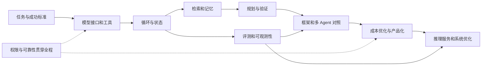

# Agent 知识点覆盖矩阵

深度标记：**实现**＝自己写过并验收；**理解**＝能解释机制和适用边界，并分析案例；**选修**＝主线完成后按方向深入。

下面是为本项目设计的知识体系。CS2680 覆盖 Agent 与系统主线，RAG 产品化、协议集成等由补充材料和自定义实验补齐。材料链接统一见 [资料导航](03-resources.md)。

| 编号 | 知识域 | 应覆盖的具体知识点 | 深度 | 周 / 实验 | 证明掌握的问题或作品 |
| --- | --- | --- | --- | --- | --- |
| K01 | Agent 基本模型 | 目标、环境、观察、动作、状态、反馈、终止；workflow 与动态决策 | 实现 | 1–2 / L01–02 | 同一个任务分别用脚本、单次模型调用、Agent 解决，说明取舍 |
| K02 | LLM 与推理 | tokenizer、上下文窗口、采样、结构化输出、模型能力边界、幻觉；Transformer 推理回顾 | 理解+接口实现 | 2、13 | 解释为什么更多上下文/更多推理 token 不保证更好 |
| K03 | 模型接入 | 消息与角色、tool call ID、流式事件、用量、错误码、限流、取消、模型适配层 | 实现 | 2–3、12 | 替换模型适配器，不改工具和评分器 |
| K04 | Prompt 与上下文 | 指令层次、示例、输出契约、资料边界、token 预算、压缩、工具结果裁剪 | 实现 | 2、5、11 | 压缩前后任务质量对照；来源信息保留 |
| K05 | 工具设计 | 名称与描述、schema、参数类型、返回类型、只读/写入区分、最小接口、工具发现 | 实现 | 3 | 模型提供的每个参数都被程序验证 |
| K06 | 运行时控制 | 状态机、调度、停止、超时、取消、重试、退避、幂等、预算、checkpoint | 实现 | 2–3、5、12 | 崩溃恢复不重复提交写操作，错误有终态 |
| K07 | 检索与知识 | 文档解析、分块、元数据、embedding、关键词/向量/混合检索、rerank、召回与精度、引用 | 实现 | 4 | 检索召回失败与模型理解失败分别诊断 |
| K08 | Agentic RAG | 查询改写、迭代检索、检索停止、证据冲突、来源可信度、资料时效 | 实现 | 4、6 | 能处理需要两次检索的问题；不能回答时明确证据不足 |
| K09 | 记忆 | 会话状态、工作记忆、语义/事件/程序性记忆、写入策略、检索、遗忘、冲突处理 | 核心实现，其余理解 | 5 | 只持久保存有依据的信息；能更正、删除和隔离 |
| K10 | 规划与推理 | ReAct、plan-execute、任务分解、DAG、反思、验证、重规划、搜索、test-time compute | 前六项实现；搜索理解 | 6 | 计划不是执行证据；证明新增规划步骤是否提升结果 |
| K11 | 多 Agent | orchestrator/worker、handoff、角色、上下文隔离、共享状态、并行、消息协议、冲突/死锁 | 小规模实现 | 10 | 在相同预算下与单 Agent 比较，解释协调开销 |
| K12 | 协议与框架 | 工具调用与 MCP 的关系；client/server、tools/resources/prompts、传输、认证边界；图编排 | MCP+一种框架实现 | 9 | 同一个工具能通过本地和 MCP 两种方式接入；状态由谁持有 |
| K13 | 协议扩展 | Agent 间通信协议、跨组织身份、远程发现、版本兼容 | 理解/选修 | 9–10 后 | 能区分工具接入、Agent 间协作和普通 API；不把协议当作能力本身 |
| K14 | 评测设计 | 成功判定、工具调用正确性、引用支持率、回归、可靠性、盲评、LLM judge 偏差、数据泄漏 | 实现 | 1、7、16 | 测试任务和评分规则先于优化冻结 |
| K15 | 实验方法 | 简单基线、公平预算、重复试验、消融、配对比较、置信区间、错误分类、负结果 | 实现 | 7、10–11、16 | 不能仅以一条成功轨迹宣称整体提升 |
| K16 | 可观测性 | run/step/tool 标识、时间戳、结构化事件、tokens、费用、失败原因、版本与追踪 | 实现 | 2 起持续 | 能从失败输出回到工具结果和配置；日志脱敏 |
| K17 | 安全与权限 | 提示注入、路径越界、命令注入、秘密泄漏、数据来源信任、最小权限、审批、审计 | 实现 | 3、8 | 权限检查位于实际执行路径；模型不能通过文本自行提权 |
| K18 | 执行隔离 | 进程/容器/远程沙箱、网络和文件限制、资源限额、依赖安装风险、环境重置 | 基础实现+理解 | 8、12 | 解释普通 subprocess 为什么不等于安全沙箱 |
| K19 | 人机协作 | 意图澄清、可预览动作、批准/拒绝、恢复、撤销、来源展示、失败沟通 | 实现 | 8、12 | 写操作前展示实际目标和变更；取消后无新副作用 |
| K20 | 应用工程 | CLI、HTTP、简单 UI、配置、密钥、SQLite、任务队列概念、包管理、测试、部署 | MVP 实现 | 5、12 | 全新终端可复现；不依赖隐藏手工步骤 |
| K21 | Agent 经济性 | token 与调用次数、模型路由、缓存、并发、早停、费用上限、每成功任务成本、Pareto | 实现 | 11 | 计入失败成本，比较同一任务分布 |
| K22 | 系统基础 | 并发/异步、吞吐/尾延迟、队列、背压、内存层次、CPU/GPU、带宽与计算瓶颈 | 理解+局部实验 | 3、13–15 | 能解释并发上升后延迟变差；能读 profiling 结果 |
| K23 | 模型服务 | prefill/decode、KV cache、显存预算、批处理、调度、TTFT、每 token 延迟、吞吐 | 理解+条件实测 | 13–14 | 说明权重能装下为何不等于请求能稳定服务 |
| K24 | 服务优化 | prefix caching、量化、推测解码、KV 压缩、路由、负载均衡、剪枝 | 全部理解，至少一项实测 | 14–15 | 对质量与速度做共同报告；不把估算标成 GPU 实测 |
| K25 | 学习型 Agent | SFT、LoRA、偏好学习、RL、奖励设计、轨迹筛选、离线/在线学习、分布漂移 | 理解/选修 | 16 后 | 先解释为什么 prompt、工具或检索改进不足，再考虑训练 |
| K26 | 自改进系统 | 失败挖掘、离线策略优化、版本评测、回滚、过拟合、受控 harness 改动 | 理解；离线迭代实现 | 11、16 | 改动必须经过独立评测，不能自改评分标准后宣称进步 |
| K27 | 特定应用 | coding、数据、浏览器、视觉、语音、机器人、科学和数学 Agent | 选定一类实现，其余理解 | 项目 / 选修 | 根据环境和可验证反馈选架构，不凭角色数量判断先进程度 |

## 依赖关系

## 完成标准

每个知识域记录四种状态：未开始 → 能解释 → 已实现/已分析 → 已验收。阅读完一篇文章只支持“已阅读”，不能自动标记“已掌握”。

必修实现项需要代码或实验记录；理解项需要一段不依赖 AI 的解释和一个反例；选修项允许留空。基础知识遗漏可随时新增，不以此表宣称穷尽所有 Agent 研究。
