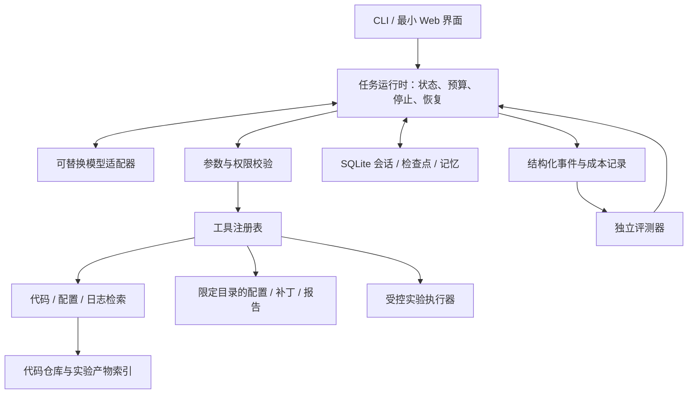

# 毕业项目：ExperimentAgent 代码实验助手

2026-10-21：学习者已选择代码实验 Agent。下方类别表保留作对照；当前开发、教学与验收均采用本文件的代码实验方案。

## 哪类 Agent 适合你

下表是针对“Python/深度学习基础很好、每天 2–3 小时、希望系统学会 Agent”做的项目判断，不是行业排名。课程项目允许学习、研究和个人工作流等方向，可参考[CS2680 项目页](https://cs2680.com/project)。

| 类别 | 实际能做什么 | 训练重点 | 验收方式 | 初期难度与建议 |
| --- | --- | --- | --- | --- |
| 学习 / 研究助手 | 检索课程资料、带来源解释、比较方法、整理笔记、生成练习 | RAG、记忆、规划、引用、评测 | 标准问题、证据支持、跨会话状态、产物完整性 | 中等；本次未选 |
| 代码 / 实验助手 | 理解小代码库、修复 bug、运行测试、启动受控实验、总结日志 | 工具设计、代码检索、执行隔离、验证反馈 | 测试通过、改动正确、实验可复现 | 中高；本次已选 |
| 数据分析助手 | 查表、生成只读 SQL、分析 CSV、画图、解释结果 | schema 检索、类型约束、计算工具、业务评测 | 已知统计量、查询结果、图表一致性 | 中等；如果有真实数据任务，回报很直接 |
| 浏览器 / 办公助手 | 在网站中查找信息、填写表格、完成多步业务流程 | 环境观察、动作定位、长任务恢复、权限 | 网站真实状态变化、可重置任务 | 较高；建议作为第二阶段专项 |
| 团队知识 / 业务助手 | 回答内部知识、整理工单、协助处理业务流程 | 权限检索、身份、多租户、服务集成、审批 | 业务规则与真实任务完成度 | 中高；依赖可用业务系统和数据 |
| 视觉 / 语音 / 具身 Agent | 理解屏幕、语音交互、控制仿真或机器人 | 多模态感知、实时闭环、环境建模 | 仿真成功率、延迟和动作正确性 | 高；需要额外环境，放在核心系统之后 |

教学采用小步推进：先理解反馈循环，再写普通工具和确定性工作流，再接入模型决策。实验环境先小后大，避免把模型训练问题和 Agent 运行时问题混在一起。

## 已选方案：ExperimentAgent

**一句话目标：** 给定代码仓库和实验目标，助手能定位相关代码、生成允许范围内的配置、运行实验、验证产物、诊断失败，并产出可复现报告。

第一版任务保持集中：

1. 阅读小型 Python 项目的 README、配置和源码，找出实验入口。
2. 按用户约束选择学习率等参数；记录代码版本、数据划分、环境和随机种子。
3. 调用受控实验执行器，查询状态，核验输出属于本次运行。
4. 从真实产物计算对照指标；区分训练、验证、测试数据的用途。
5. 失败时先诊断并有限重试；后续版本才增加限定文件中的代码修复和回归测试。
6. 中断后恢复，报告成功、失败和未执行的实验，不以文本宣称替代执行证据。

首个练习项目：CPU 上的小型合成数据线性回归实验。任务为在固定数据划分、初始化种子和训练步数下比较两个学习率，报告验证集 MSE 与耗时。这样可先聚焦 Agent 的决策与验证，再迁移到 PyTorch 深度学习项目。2026-10-25，AI 已创建并实际运行标准库 CPU 训练，两组固定学习率产物按 run_id 验收，见 [第 27 课](../lessons/27-real-linear-regression.md)。学习者独立运行、模型配置选择及整项任务验收尚未完成。

暂不放进第一版：任意网站自动操作、无人监督的任意 shell 执行、自动发邮件、训练大模型、复杂多用户平台。这些能力会显著增加范围，应在核心验收之后逐项加入。

## 用户任务样例

| 任务 | 预期行为 | 如何证明做对了 |
| --- | --- | --- |
| “这个项目从哪里启动训练？” | 检索 README、配置和实际入口 | 文件路径与代码相符，区分说明与已验证运行 |
| “比较学习率 0.01 和 0.1，其他条件保持一致。” | 检查配置，执行两组实验，核对结果并生成报告 | 配置和运行关联正确；数字来自本次产物 |
| “这次实验失败了，定位原因。” | 读取退出状态、日志和相关源码，区分证据与假设 | 定位到实际错误；没有把失败写成低分成功 |
| “修复这个小 bug，并确认不影响原功能。” | 在授权文件内修改，运行预先定义的测试 | 独立测试通过；不能删除测试或放宽判据过关 |
| “继续昨天未完成的实验。” | 查询 run ID 与进程/产物状态，恢复未完成项 | 不重复运行已完成任务，不混入旧结果 |

## 架构草案

核心状态建议：`goal, messages, plan, evidence, artifacts, pending_actions, budget, checkpoint, status`。计划是可调整的工作记录，任务成功由实际工具输出和验收条件确定。

实验记录至少包含 `run_id, code_version, config, seed, data_split_id, environment, exit_code, metrics, artifact_paths`。代码版本可使用 Git 提交加改动摘要，或受控输入文件的内容哈希；未提交改动也必须可追踪。模型 API 预算与实验 CPU/GPU 时间分别限制。

工具按课程逐步加入：`read_file`、`search_code`、`read_config`、`run_experiment`、`get_run_status`、`read_metrics`、`run_tests`、`write_report`；代码修改工具在具备权限、补丁预览与回归验证后加入。长任务启动返回 run ID，由查询工具跟踪，不假定一次调用即可等待全部训练完成。

建议自己实现的部分：运行循环、工具契约、预算/停止、证据结构、权限检查、评测器、任务状态和项目业务逻辑。模型本身、HTTP SDK、向量算法与数据库可复用成熟库。“自己创建 Agent”意味着理解并掌握系统控制逻辑，不要求从零训练基础模型。

## 版本递进

| 版本 | 截止关卡 | 新增能力 | 交付物 |
| --- | --- | --- | --- |
| v0.1 | 第 2 周 | 最小模型–工具闭环 | CLI 原型、模拟模型测试、可见执行日志 |
| v0.2 | 第 4 周 | 代码/配置检索和来源追踪 | 代码定位与检索对照报告 |
| v0.3 | 第 6 周 | 实验记录、恢复、规划 | 实验对照、失败诊断和恢复演示 |
| v0.4 | 第 8 周 | 系统评测和权限可靠性 | 开发集基线、对抗测试报告 |
| v0.5 | 第 11 周 | 可选框架/MCP、多 Agent 对照、成本优化 | 消融实验与架构取舍记录 |
| v1.0-api | 第 12 周 | 可日常使用 | 使用手册、界面、配置与回归 |
| v1.0-final | 第 16 周 | 完整交付和系统实验 | 最终评测、演示、已知限制、实测资源说明 |

## 数据与评测协议

建议共 60 个任务：40 个开发任务、20 个保留测试任务。分五类，每类开发 8 个、测试 4 个：代码理解与定位、实验配置与执行、结果比较与报告、有限代码修复、故障恢复与权限边界。任务依赖与产物分组切分，避免同一 bug 或实验变体同时泄漏到开发和测试中。这个规模适合学习项目，不能据此宣称普遍可靠。

每个任务定义：`id, category, user_request, initial_state, allowed_tools, expected_outcome, evidence_refs, evaluator, budget_limit`。预期答案与系统可读资料分开保管。

基线至少包括：直接调用同一模型；固定检索/固定步骤流程；最终 Agent。多 Agent 作为额外候选，不预设优胜。

任务成功采用每任务 rubric：必要产物存在、配置与 run ID 一致、结果计算正确、独立测试通过、授权边界满足。运行成功不等于代码正确；测试通过也只支持测试覆盖范围内的结论。对有主观成分的诊断说明先人工校准 rubric；不能单凭另一模型“觉得不错”判定成功。

### 暂定毕业目标

这些是本项目设计目标，不是已测量结果，也不是原课程评分线。第 7 周在开发集校准后、看保留集前冻结。

- 总体保留任务成功率目标 ≥80%，同时报告每类任务结果，避免整体均值掩盖短板。
- 报告的全部数值指标必须能追溯到正确 run ID 的实际产物；代码位置和失败诊断提供对应代码/日志证据；不允许把旧运行结果归到新配置。
- 固定权限回归用例全部通过；这只证明指定用例通过，不证明全面安全。
- 故障任务要么恢复成功，要么给出可诊断终态；无无限循环和失控重试。
- 报告每任务成本、每成功任务成本、总费用、p50/p95 延迟和重复运行波动；早期不设无依据的统一美元或秒数门槛。
- 至少一项优化在质量满足预设约束时降低成本或延迟；若没有改善，保留可信的负结果与原因也可完成学习验收。
- 能从新的终端按文档复现，学习者能解释并改动核心循环和一个工具。

延迟统计要提供样本数；预算不足而只跑少量任务时，p95 只作观察值。API 模型可能随服务更新发生变化，记录模型标识、日期和可用版本信息，尽量进行同批配对比较。

## 资源与项目边界

先用 API 或可用模型接口完成主要 Agent 能力。GPU 实验与日常产品版本分开评估：小模型更便宜或更快，不代表回答与工具使用质量相同。

所有 API/GPU 费用在实验前用任务数、调用次数和实际单价估算，并配置运行上限。当前未选择供应商、未确认预算、未创建付费资源。

原课程的校内计算资源不默认可用；本项目已有 Anaconda，GPU 型号、显存和服务端环境仍待核验。系统实验根据实际资源调整，但缺失的测量必须诚实留作待完成。
